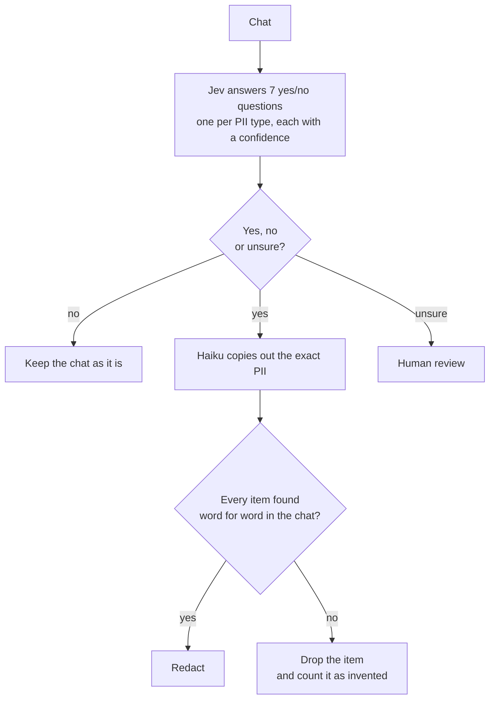
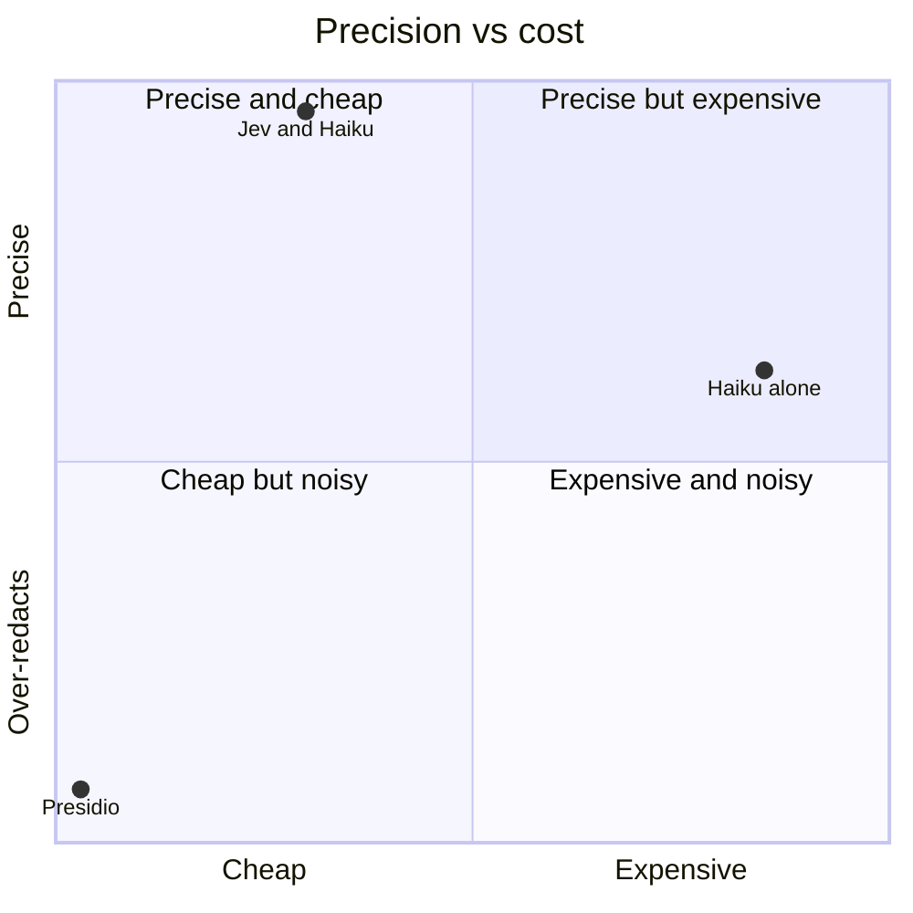

# PII Detection with Jev

### Can a small, cheap model make PII redaction safer than an LLM on its own?

> **Agent:** Go ahead with the card number.
> **Customer:** 4166 6870
> **Agent:** Got it, keep going.
> **Customer:** 0217 6598.

Support chats get stored, searched, analysed and sent to vendors. Before any of that happens, card numbers, ID numbers, phone numbers and addresses need to come out. The chat above is the hard case: the card number is split across two messages, and neither half looks like a card on its own.

Chats are also full of things that *look* like PII but aren't: order numbers, tracking numbers, the last 4 digits of a card, delivery dates, a first name in "Hi James". Redact those and the chats become useless for anyone who reads them.

I ran the same 350 held-out chats through three setups: [Jev](https://typesafe.ai) (a small judgment model from TypeSafe) screening for Claude Haiku 4.5, Haiku 4.5 on its own, and Microsoft Presidio, the standard open-source PII tool.

## ⚙️ How it works


*The 7 types: full name, card number, NRIC / passport, address, phone, email, date of birth.*

Jev reads every chat. Haiku only sees the chats Jev flags, which was 61 of 350 in the test. Card and ID numbers are high risk, so they go to a person when Jev is under 95% sure. The other five go to a person when Jev is under 80% sure. An unsure chat still goes to Haiku, so the person sees what was found. Haiku can't change the chat: Python checks that every item it returns appears in the chat character for character.

## 🎯 The release gate, in priority order

The tool ships only if it passes all four checks.

| # | Check | Target | What it checks |
|---|---|---|---|
| 1 | **High-risk leaks** | 0 | No card or NRIC / passport number is left in a chat. A number counts as safe if it was redacted, or if the chat went to a person to check. |
| 2 | **Precision** | over 90% | At least 9 in 10 redacted items are real PII, so the redacted chats are still readable. |
| 3 | **Invented text** | 0 | Every redacted item is copied word for word from the chat, so redaction never adds or changes text. |
| 4 | **Cost** | under $0.50 per 1,000 chats | Cheap enough to run on every chat. |

## 🏁 The result

| | Jev + Haiku | Haiku alone | Presidio |
|---|---|---|---|
| **Release gate** | ✅ **Ship** | ❌ Fail | ❌ Fail |
| 1. High-risk leaks | ✅ 0 of 7 | ✅ 0 of 7 | ❌ 2 of 7 |
| 2. Precision | ✅ 96% | ❌ 62% | ❌ 7% |
| 3. Invented text | ✅ 0 | ✅ 0 | ✅ 0 |
| 4. Cost per 1,000 chats | ✅ $0.26 | ❌ $0.85 | ✅ free |
| PII found | 69 of 69 | 69 of 69 | 50 of 69 |
| Clean chats changed by redaction | 2 of 298 | 38 of 298 | 267 of 298 |
| Chats sent to a person | 16 (4.6%) | none | none |

*Scored on 350 held-out chats.


*Cost per 1,000 chats from $0 to $1. Precision is the share of redacted items that were real PII.*

Both Claude setups found every piece of PII. The difference is what else they redacted. Haiku on its own kept treating first names as full names:

| Original | Jev + Haiku | Haiku alone |
|---|---|---|
| Agent: Hi James, welcome back! | *unchanged* | Agent: Hi [FULL_NAME], welcome back! |
| Customer: Just call me Ravi, that's fine. | *unchanged* | Customer: Just call me [FULL_NAME], that's fine. |

Presidio missed half of the split card number above and labelled it a phone number. It also missed an NRIC written in Malay ("Nombor kad pengenalan saya T5818141I") and tagged the Malay words as a person's name.

## 💡 What I learned

- **Finding PII was the easy part.** Both Claude setups found 69 of 69. What separated them was precision, so the gate needed a check for it.
- **Screening helps quality, not just cost.** Haiku made the same first-name mistakes in both setups. Behind Jev it only saw 61 chats, so it had far fewer chances to make them.
- **Rules-based tools struggle with real chats.** Presidio is built on patterns and English NER. Numbers split across messages, other languages and lookalike numbers are exactly where it breaks.
- **Jev's confidence was trustworthy.** When Jev was 95% sure or more (2,406 answers), it was right every time. That's what makes "send it to a person when unsure" work: only 4.6% of chats needed a person.

## 🔭 What I'd do next

1. **Test more high-risk PII.** Many more card and ID numbers, written in as many different ways as possible.
2. **Test more languages.** Jev caught the PII in all 6 test chats written in Malay, Tamil and Chinese. Next, I'd check whether Jev is as good in other languages as it is in English.
3. **Try real chat logs and other markets.** The data is synthetic and Singapore-flavoured, though the prompts are kept country-neutral.

## 🚀 Try it

```bash
pip install -r requirements.txt && cp .env.example .env    # add TYPESAFE_API_KEY and OPENROUTER_API_KEY
python pii_detect.py ecom_realistic_dev_150.csv            # Jev + Haiku on the dev set, Excel report in runs/

# the final test
python compare_test.py jev                                 # Jev + Haiku
python compare_test.py haiku                               # Haiku alone
python compare_test.py presidio-import results/final_presidio_colab.json   # Presidio, run in Colab
python compare_test.py compare                             # side-by-side release gate
python compare_test.py redact                              # redacted chats, Jev + Haiku vs Haiku alone
```

More: [Case study](docs/case-study.md) · [How it works](docs/how-it-works.md) · [Decision log](docs/decision-log.md) · [Results](results/)

*This is a demo on synthetic data, not a production system. The [case study](docs/case-study.md#limitations) lists its limits.*

## 👋 About me

I'm a product manager who builds: problem first, quality defined before building, decisions written down.
📫 **[shrikumarsneha@gmail.com](mailto:shrikumarsneha@gmail.com)**
