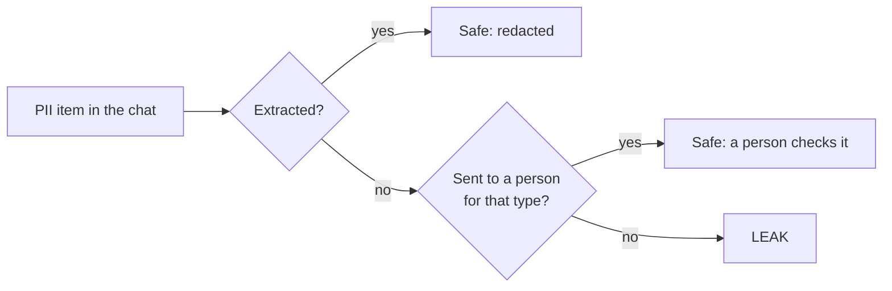

# How it works

Reference for running the tool and reading its output. For the story and the results, see the [README](../README.md).

## What it looks for

| Type | Risk | Counts | Doesn't count |
|---|---|---|---|
| `FULL_NAME` | medium | A given name with a family name, in any language or script | A first name on its own, product names ("Jack Leather Wallet"), names inside an email address |
| `CARD_NUMBER` | **high** | A full credit or debit card number, however it's written | The last 4 digits, order and tracking numbers |
| `NRIC_PASSPORT` | **high** | A national ID number from any country, or a passport number | Order, receipt and coupon codes |
| `ADDRESS` | medium | A street, block or unit number, or a postal code | A town or area on its own, the company's own stores |
| `PHONE` | medium | A private person's phone number | The company's hotline, order numbers, amounts |
| `EMAIL` | medium | A private person's email address, including "rachel dot chua at outlook dot com" | The company's own addresses |
| `DOB` | medium | A date given as someone's birth date | Delivery, order and expiry dates, ages |

All of them still count when they're split across messages, spelled out in words, written in another language, or given and then corrected.

## Step 1: Jev screens every chat

`detect_pii()` sends the chat to Jev with 7 yes/no questions, one per type. Each question is written as a short question plus "counts" and "doesn't count" criteria, with invented examples (`QUESTIONS_V2` in `pii_detect.py`). The examples aren't copied from the dev chats, to limit overfitting.

Jev returns a probability `p` for each question. The answer is yes when `p` is 0.5 or more, and Jev's confidence is `max(p, 1 - p)`.

Jev is weak at reading spelled-out digits, so runs of 3 or more digit words are turned into numerals before Jev sees the chat ("nine zero zero eight" becomes "9008"). Haiku always gets the original text.

## Step 2: Human review

A type goes to a person when Jev is less sure than its risk tier allows (`REVIEW_BELOW` in `pii_detect.py`):

| Risk | Send to a person when Jev is under | Why |
|---|---|---|
| High (card, ID) | 95% sure | Leaking one of these is the worst case, so even a 5% doubt gets checked. |
| Medium (the other 5) | 80% sure | Still worth a look, without flooding reviewers. |

On the test set this sent 16 of 350 chats (4.6%) to a person. 9 of them had no PII.

## Step 3: Haiku extracts the text

`extract_pii()` only runs when Jev said yes to something or was unsure. It sends the chat to Claude Haiku 4.5 through OpenRouter, with the types Jev flagged as a hint. Haiku returns a list of `{label, text}` items in a fixed JSON schema.

Python then checks each item. If its text isn't in the chat character for character, the item is dropped and counted as invented text. Haiku can't change the chat; it can only point at parts of it.



## Redaction

Redaction is a separate step, run only when you ask for it. `redact_pii()` replaces every extracted item with its label, longest first:

> Customer: My number is 9123 4567 → Customer: My number is [PHONE]

`python compare_test.py redact` writes the redacted test chats for Jev + Haiku and for Haiku alone, next to the expected redaction. It marks text hidden for no reason (over-redaction) in amber and PII left visible in red.

## Scoring

The label columns in the CSV (`has_pii`, `pii_types`, `tags`, `spans_json`) never reach either model. They're used afterwards to score the answers.

- **Recall and leaks** are counted per expected PII item, using its character span. An extracted item that overlaps the span counts as found.
- **Precision** is the share of extracted items that overlap an expected PII span, across all 7 types.
- **Cost** uses the real cost OpenRouter reports for Haiku, and Jev's published price per token.

### Release gate, in priority order

| # | Check | Passes when |
|---|---|---|
| 1 | High-risk leaks | 0 card or ID numbers leaked |
| 2 | Precision | over 90% of extracted items are real PII |
| 3 | Invented text | 0 Haiku items not found in the chat |
| 4 | Cost | under $0.50 per 1,000 chats, Jev and Haiku together |

## The comparison

`compare_test.py` runs the two other setups and scores all three with the same gate.

| Setup | How it's run |
|---|---|
| Haiku alone | Every chat goes to Haiku, with the same prompt minus the screening hint. Telling Haiku that all 7 types were flagged made it worse (50 clean chats changed instead of 38), so the fairer version is the one reported. |
| Presidio | Default settings with spaCy `en_core_web_lg`. Presidio has no address or birth-date type, so `LOCATION` stands in for address and `DATE_TIME` for birth date. ID types from any country count as NRIC / passport. Presidio can't flag chats for a person. |

Presidio wouldn't run on my Windows machine (Smart App Control blocks spaCy), so `presidio_colab.ipynb` runs it in Google Colab. The notebook has the test chats built in (id and text only, no labels), and its output is in [results/final_presidio_colab.json](../results/final_presidio_colab.json).

## Output

Each `pii_detect.py` run writes an Excel workbook to `runs/`:

- **Results:** one row per chat. For each type, the expected answer sits next to Jev's answer and confidence, green when they match and red when they don't. Bold italic means the type was sent to a person.
- **Summary:** the release gate first, then leaks by type, review workload, what other review bars would do, scores per type, a confidence check, extraction scores, and cost.

Every chat is also traced to LangSmith (`pii_chat`, with `jev_detect` and `llm_extract` inside it), with correctness scores attached as feedback.

## Setup

```bash
pip install -r requirements.txt
cp .env.example .env      # then fill in the keys
```

| Variable | Needed for |
|---|---|
| `TYPESAFE_API_KEY` | Jev |
| `OPENROUTER_API_KEY` | Claude Haiku 4.5 |
| `LANGSMITH_API_KEY` | Tracing (optional, or run with `--no-trace`) |

Keys already set in your environment take priority over `.env`.

## Commands

```bash
python pii_detect.py ecom_realistic_dev_150.csv                 # Jev + Haiku on the dev set
python pii_detect.py ecom_realistic_dev_150.csv --limit 5       # first 5 chats only
python pii_detect.py ecom_realistic_dev_150.csv --ids ECOM_REALISTIC-0006,ECOM_REALISTIC-0099
python pii_detect.py ecom_realistic_dev_150.csv --questions v1  # the first question wording

python compare_test.py jev          # Jev + Haiku on the test set
python compare_test.py haiku        # Haiku alone on the test set
python compare_test.py colab        # writes presidio_colab.ipynb
python compare_test.py presidio-import results/final_presidio_colab.json
python compare_test.py compare      # the three-way comparison
python compare_test.py redact       # the redacted chats
```

## Data

Both files are synthetic e-commerce support chats with a Singapore flavour: 150 for development (`ecom_realistic_dev_150.csv`) and 350 held out for the final test (`ecom_realistic_test_350.csv`). About 15% of chats contain PII, which is closer to real traffic than a PII-heavy set and makes false alarms count.

Most chats contain traps: order and tracking numbers (117 test chats), product names that contain first names (89), company hotlines and emails (80), non-birth dates (74), lone first names (70), place names (52) and partial card numbers (37). The PII itself comes in plain, split, spelled-out, self-corrected and non-English forms.
